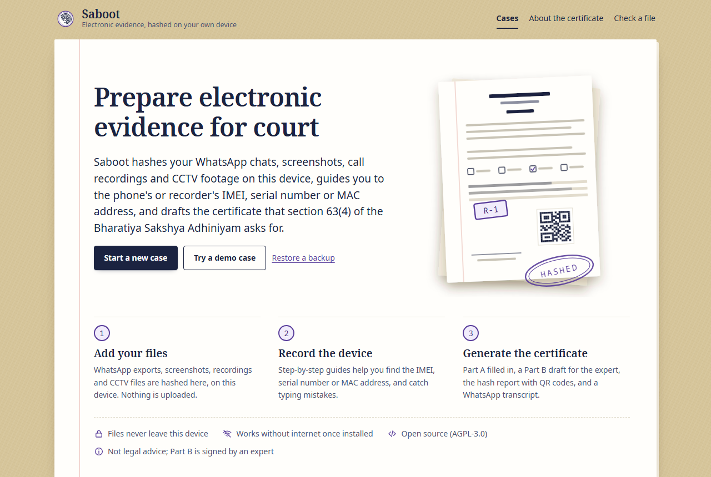
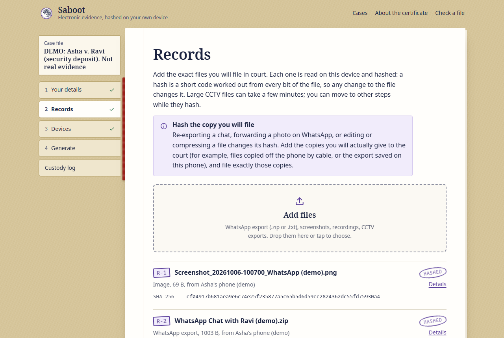
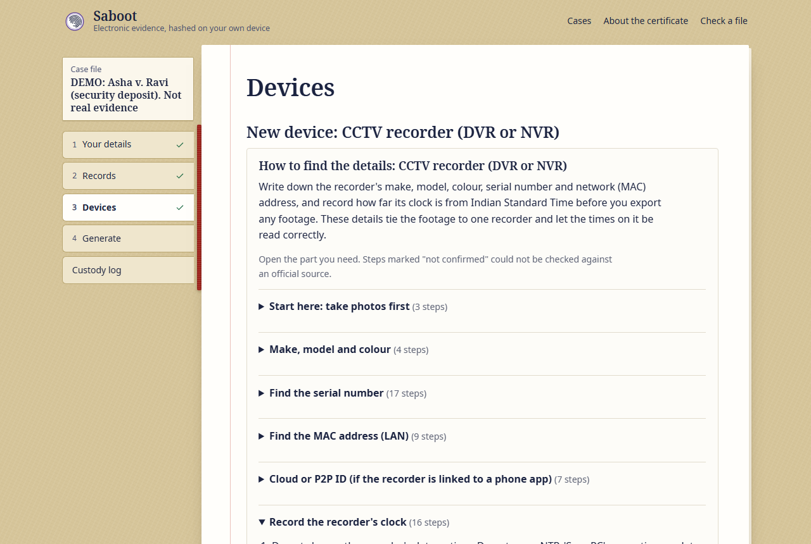
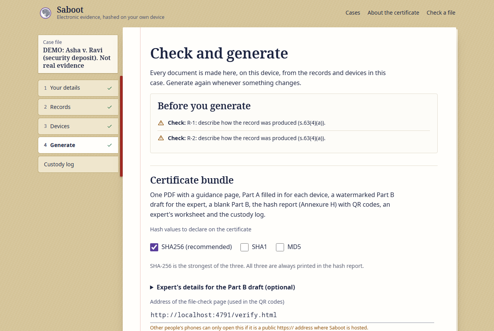
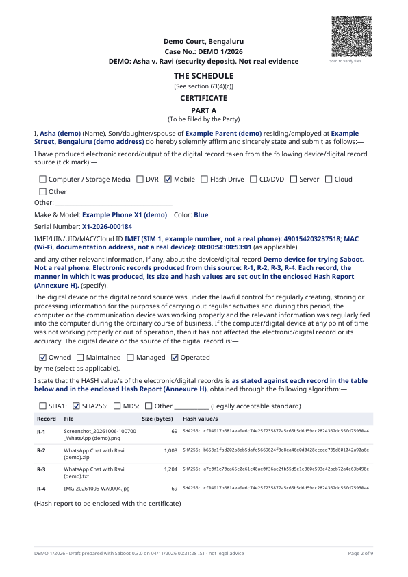
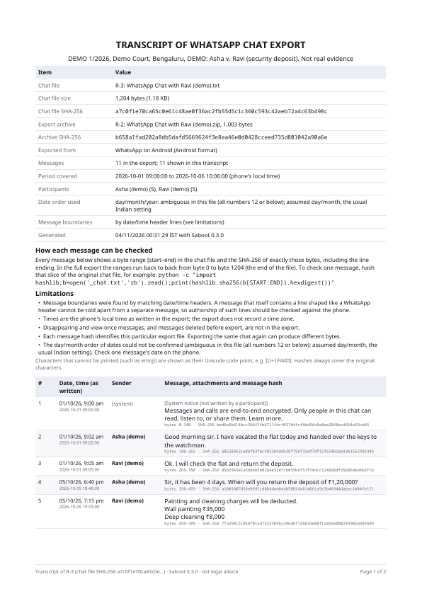
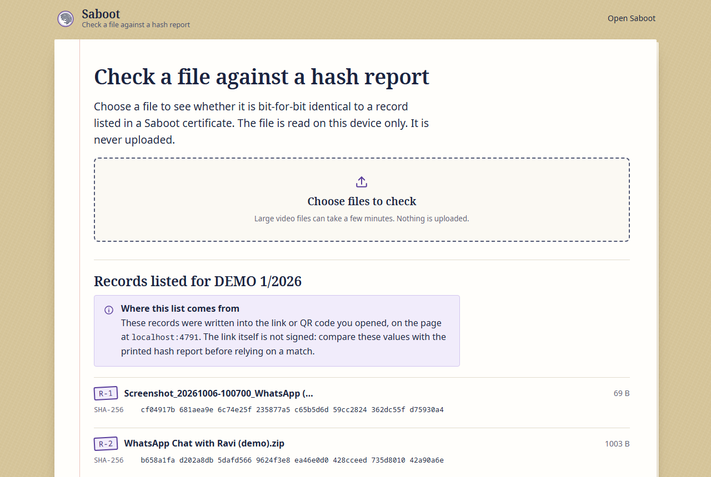

<div align="center">


# Saboot

**Prepare electronic evidence for Indian courts, on your own device.**

[](https://github.com/byjoellobo/saboot/actions/workflows/ci.yml)
[](https://github.com/byjoellobo/saboot/actions/workflows/pages.yml)
[](https://github.com/byjoellobo/saboot/releases)
[](LICENSE)


[**Open the app**](https://byjoellobo.github.io/saboot/) · [Check a file](https://byjoellobo.github.io/saboot/verify.html) · [Releases](https://github.com/byjoellobo/saboot/releases) · [Changelog](CHANGELOG.md)

</div>

Saboot (सबूत, "proof") hashes WhatsApp chat exports, screenshots, call recordings and CCTV footage **on the user's own device**, guides them to the IMEI, serial number or MAC address of the device the files came from, and drafts the certificate required by **section 63(4) of the Bharatiya Sakshya Adhiniyam, 2023 (BSA)**: Part A filled in, a Part B draft for the expert, a hash report with QR codes anyone can use to check the files, and a WhatsApp transcript where every message has its own hash.

> [!IMPORTANT]
> **Not legal advice, and not the expert.** Saboot is a software tool. Part B of the certificate must be completed and signed by an expert who examines the records independently, and every document should be reviewed by a practising advocate before it is filed. See [DISCLAIMER.md](DISCLAIMER.md).

<p align="center">
  
</p>

| Records, hashed on the device                              | Device guide                                                 | Generate the documents                     |
| ---------------------------------------------------------- | ------------------------------------------------------------ | ------------------------------------------ |
|  |          |  |
| **Certificate, Part A**                                    | **WhatsApp transcript**                                      | **File check page**                        |
|   |  |       |

Sample outputs from the built-in demo case (synthetic data): [certificate bundle](docs/images/demo-certificate.pdf) and [WhatsApp transcript](docs/images/demo-transcript.pdf).

## Why

Section 63(4) of the BSA requires a certificate "at each instance" an electronic record is submitted. The form in the Schedule has a Part A signed by the party and a Part B signed by an expert, and **both** carry the hash value block (SHA1 / SHA256 / MD5) with the note "(Hash report to be enclosed with the certificate)". On 22 May 2026 the Supreme Court declined to entertain a challenge to the provision (_Pune Bar Association v. Union of India_, W.P.(C) 599/2026), calling a hash value "synonymous with an electronic fingerprint", and kept open who may sign Part B.

The burden falls hardest on people without lawyers or forensic labs: tenants with WhatsApp chats about a deposit, workers with screenshots of deductions, shopkeepers with CCTV footage. Existing aids are a downloadable template and closed "evidence vault" products; open capture tools such as Bellingcat's Auto Archiver and Harvard's Scoop do not produce this certificate or guide a non-lawyer through it. Saboot does, and it is open source so that anyone, including the court and the other side, can inspect how every hash was computed. Sources: [docs/research/legal.md](docs/research/legal.md).

**About the name.** The project was developed as "Sakshya Kit". It was renamed before its public release so that it cannot be mistaken for e-Sakshya, the government's police evidence app.

## Features

|                            |                                                                                                                                                                                                                                                                                                                                             |
| -------------------------- | ------------------------------------------------------------------------------------------------------------------------------------------------------------------------------------------------------------------------------------------------------------------------------------------------------------------------------------------- |
| **Streaming hashes**       | MD5, SHA-1, SHA-256 and CRC32 in one pass, by a Rust crate compiled to WebAssembly and run in a pool of Web Workers reading 8 MiB at a time, so multi-GB CCTV files never load into memory                                                                                                                                                  |
| **WhatsApp exports**       | The zip and every file inside it are hashed and CRC-checked; the chat is parsed with exact byte ranges for Android and iPhone formats ([docs/research/whatsapp.md](docs/research/whatsapp.md))                                                                                                                                              |
| **Per-message transcript** | Page-numbered PDF where each message shows its byte range and SHA-256, with attachments linked to their own hashes; Hindi, Kannada, Tamil, Telugu, Bengali, Malayalam, Gujarati, Gurmukhi and Odia print correctly                                                                                                                          |
| **Device guides**          | Step-by-step help for Android, iPhone, CCTV recorders (Hikvision/Prama, Dahua, CP Plus, XMeye), Windows, macOS and more, each step marked by how well it is sourced ([docs/research/devices.md](docs/research/devices.md)); IMEI Luhn check, randomised-MAC warning, EID check, placeholder-serial detection, recorder clock-offset capture |
| **Certificate bundle**     | Guidance page, Part A filled per device in the Schedule's exact words, watermarked Part B draft, blank Part B, Annexure H hash report with QR codes, expert's worksheet, Annexure C custody log                                                                                                                                             |
| **Hash lists**             | `SHA256SUMS` (works with `sha256sum -c`) and a CSV for experts                                                                                                                                                                                                                                                                              |
| **Check page**             | QR codes open [`verify.html`](https://byjoellobo.github.io/saboot/verify.html), which hashes a file on the viewer's device and reports a match; it also loads a `SHA256SUMS` list or case backup, and checks a single WhatsApp message by byte range. The QR payload sits after the `#`, which browsers never send to a server              |
| **Custody log**            | Every action is logged; each entry carries the SHA-256 of the previous one                                                                                                                                                                                                                                                                  |
| **Offline and private**    | Installable PWA; data stays in the browser (IndexedDB); no accounts, analytics or cookies ([PRIVACY.md](PRIVACY.md))                                                                                                                                                                                                                        |
| **Optional timestamp**     | RFC 3161 timestamp for a generated PDF via [`pdf-rfc3161`](https://github.com/mingulov/pdf-rfc3161); only the PDF's hash is sent, and only when you press the button                                                                                                                                                                        |
| **Demo case**              | "Try a demo case" builds a complete case from synthetic files so you can see every output without real evidence                                                                                                                                                                                                                             |

## Use it

- **In the browser:** open <https://byjoellobo.github.io/saboot/> and press **Try a demo case**. After the first visit it works without internet; use **Install app** (Android, desktop) or Share > Add to Home Screen (iPhone) to keep it on the device.
- **Host your own copy:** download `saboot-vX.Y.Z-web.zip` from the [latest release](https://github.com/byjoellobo/saboot/releases/latest), check it with `sha256sum -c SHA256SUMS`, and serve the folder from any HTTPS static host at the site root. QR codes point to `<your site>/verify.html`.

## Develop

```bash
git clone https://github.com/byjoellobo/saboot.git
cd saboot
npm ci
npm run dev            # http://localhost:5173
```

Node 20.19 or later (CI uses 24). Rust is needed only to change the hasher: install Rust 1.99.1 (pinned in `crates/saboot-hash/rust-toolchain.toml`) with the `wasm32-unknown-unknown` target, then `npm run wasm`. On Windows without Visual Studio Build Tools, `scripts/cargo.mjs` uses rustup's GNU toolchain automatically.

| Command                                   | What it does                                                                 |
| ----------------------------------------- | ---------------------------------------------------------------------------- |
| `npm run dev`                             | Development server                                                           |
| `npm run build`                           | Rebuild the wasm (if Rust is available), type-check, production build        |
| `npm test` / `npm run test:coverage`      | Unit tests (Vitest; the real wasm runs in Node)                              |
| `npm run test:e2e`                        | Playwright end-to-end tests against the production build, desktop and phone  |
| `npm run test:rust` / `npm run lint:rust` | Rust hasher tests / clippy with warnings as errors                           |
| `npm run lint` / `npm run format:check`   | ESLint / Prettier                                                            |
| `npm run wasm:check`                      | Rebuild the hasher and fail if the committed `.wasm` differs from the source |

## How it works

```
 File picked ─▶ worker pool ─▶ Rust/wasm hasher ─▶ record (R-n) + custody entry ─▶ IndexedDB
     │               │
     │               └─ zip: central-directory reader ─▶ every entry hashed, chat text parsed
     ▼
 Device guide ─▶ identifiers checked (Luhn, MAC bits, EID) ─▶ device
     ▼
 Generate ─▶ pdf-lib layout (Noto fonts, Indic shaping) ─▶ certificate / transcript PDF
           └▶ QR codes: expected hashes in the URL fragment ─▶ verify.html (offline check)
```

The code is split into a reusable **engine** (`src/engine`: hashing, zip, PDF, custody log, verify links) that knows nothing about the BSA, the **BSA layer** (`src/sakshya`, named after the Act: Schedule text, certificate, checks, device guides, WhatsApp parser), and the **app** (`src/app`, `src/verify`). See [docs/ARCHITECTURE.md](docs/ARCHITECTURE.md).

## CI/CD and releases

- **CI** ([`ci.yml`](.github/workflows/ci.yml)): lint, formatting, types, unit tests with coverage thresholds, production build, end-to-end tests, Rust tests and clippy, and a byte-for-byte check that the committed wasm matches the Rust source.
- **Deploy** ([`pages.yml`](.github/workflows/pages.yml)): every push to `main` publishes the app to GitHub Pages.
- **Release** ([`release.yml`](.github/workflows/release.yml)): pushing a `vX.Y.Z` tag runs the checks and publishes a GitHub release with the web bundle, sample PDFs, `SHA256SUMS` and build provenance attestations. Notes come from [CHANGELOG.md](CHANGELOG.md).

Saboot uses [Semantic Versioning](https://semver.org/); changes that alter any hash, the verify-link format or the backup format are treated as breaking. The full process is in [docs/RELEASING.md](docs/RELEASING.md).

## Integrity and security

- Stored WhatsApp chat text is re-hashed and must match the record's SHA-256 and size before every transcript and before a backup is restored.
- The zip reader rejects impossible compression ratios, entries that point at the same data and oversized directories, inflates in 64 KiB slices, and caps how much text it keeps. Only files named `.zip` are unpacked; Word, Excel and APK files stay single records.
- Builds remap local paths out of the wasm, and CI rebuilds it from source.
- Strict Content-Security-Policy (`public/_headers`, plus a `<meta>` fallback); the only allowed outside connection is the opt-in timestamp service. No telemetry.

Report vulnerabilities privately: see [SECURITY.md](SECURITY.md).

## Known limitations

- The custody log is kept by the person preparing the evidence. Its hash chain detects edits to earlier entries, but not someone rebuilding the whole log or deleting its last entries.
- The verify link is not signed. Anyone can make a link listing any hash values; the check page says so and asks people to compare against the printed hash report.
- The timestamp service is a free third-party RFC 3161 TSA, not a government or accredited one, and the library does not validate it against a trust store.
- Android WhatsApp exports cannot distinguish a real message from a body line shaped like a header. Suspect lines are flagged in the transcript, not resolved.
- The interface is in English only for now.

## Documentation

|                                              |                                                                          |
| -------------------------------------------- | ------------------------------------------------------------------------ |
| [DISCLAIMER.md](DISCLAIMER.md)               | What Saboot is and is not                                                |
| [PRIVACY.md](PRIVACY.md)                     | What is stored, where, and what leaves the device                        |
| [SECURITY.md](SECURITY.md)                   | How to report a vulnerability; threat model                              |
| [CONTRIBUTING.md](CONTRIBUTING.md)           | Setup, project rules, tests, commits, DCO                                |
| [SUPPORT.md](SUPPORT.md)                     | Where to get help (and where to find legal aid)                          |
| [docs/ARCHITECTURE.md](docs/ARCHITECTURE.md) | How the code fits together                                               |
| [docs/RELEASING.md](docs/RELEASING.md)       | Versioning, CI/CD and the release process                                |
| [docs/research/](docs/research/)             | Sourced research behind the legal text, the parser and the device guides |
| [CHANGELOG.md](CHANGELOG.md)                 | Every release                                                            |

## Roadmap

The engine is built to be reused for other everyday evidence:

1. **Tenancy move-in record:** a two-party, dated photo record in which the other side opens a link and acknowledges each photo.
2. **Gig-worker earnings log:** deductions and deactivation notices checked against the Karnataka Platform Based Gig Workers Act, 2025.
3. **Broadband outage and speed log:** measurements turned into a complaint against TRAI's quality-of-service benchmarks.
4. **Hindi and Kannada interface,** reviewed by native speakers with legal training.

## Contributing

Contributions are welcome, especially corrections to device guides, new WhatsApp export formats (synthetic samples only), translations and accessibility fixes. Read [CONTRIBUTING.md](CONTRIBUTING.md) and the [Code of Conduct](CODE_OF_CONDUCT.md). Never attach real chats, phone numbers, IMEIs or case details to an issue.

## Licence

Saboot is free software under the **GNU Affero General Public License v3.0 or later** ([LICENSE](LICENSE)): you may use, study, modify and share it, and if you run a modified version as a service for others you must offer them its source. The standalone hasher crate in `crates/saboot-hash` is dual-licensed **MIT OR Apache-2.0**. Noto fonts are under the SIL Open Font License 1.1. See [NOTICE](NOTICE). Organisations that want to embed Saboot without the AGPL's obligations can ask about a commercial licence.

If you refer to Saboot in research or teaching, see [CITATION.cff](CITATION.cff).

## Acknowledgements

[pdf-lib](https://github.com/Hopding/pdf-lib) and `@pdf-lib/fontkit`, [pdf-rfc3161](https://github.com/mingulov/pdf-rfc3161), [fflate](https://github.com/101arrowz/fflate), [RustCrypto hashes](https://github.com/RustCrypto/hashes), [crc32fast](https://github.com/srijs/rust-crc32fast), [qrcode](https://github.com/soldair/node-qrcode), [zod](https://github.com/colinhacks/zod), [idb](https://github.com/jakearchibald/idb), [vite-plugin-pwa](https://github.com/vite-pwa/vite-plugin-pwa) and Google's [Noto fonts](https://notofonts.github.io/). The WhatsApp parser learned from [whatsapp-chat-parser](https://github.com/Pustur/whatsapp-chat-parser) and [whatstk](https://github.com/lucasrodes/whatstk).
